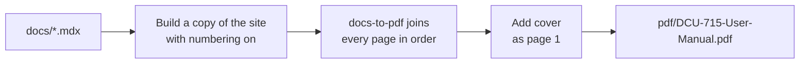

<div align="center">


# DCU 715 User Manual

**The documentation website and printable PDF manual for the ITR DCU 715 Series.**

[](https://docusaurus.io/)
[](https://nodejs.org/)
[](https://classic.yarnpkg.com/)
[](#-pdf-manual)

</div>

---

## 📖 Contents

- [DCU 715 User Manual](#dcu-715-user-manual)
  - [📖 Contents](#-contents)
  - [💡 About](#-about)
  - [🚀 Quick start](#-quick-start)
  - [🧰 Commands](#-commands)
  - [🗂 Project structure](#-project-structure)
  - [✍️ Writing documentation](#️-writing-documentation)
    - [Pages and order](#pages-and-order)
    - [Figures](#figures)
    - [Notes and warnings](#notes-and-warnings)
  - [📄 PDF manual](#-pdf-manual)
    - [What's in the PDF](#whats-in-the-pdf)
    - [How it works](#how-it-works)
    - [Customising](#customising)
    - [Troubleshooting](#troubleshooting)
  - [🌍 Deployment](#-deployment)

---

## 💡 About

This repository holds the user manual for ITR's **DCU 715** in a single source:

| Output | How it's made | Where it goes |
| --- | --- | --- |
| 🌐 **Website** | `yarn build` | `build/`, ready for any static host |
| 📄 **PDF manual** | `yarn pdf` | `pdf/DCU-715-User-Manual.pdf` |

Write a page once in `docs/` and it appears in both.

---

## 🚀 Quick start

**Requirements:** [Node.js](https://nodejs.org/) 20 or newer and [Yarn 1](https://classic.yarnpkg.com/).

```bash
# 1. Install dependencies
yarn

# 2. Start the local website
yarn start
```

The site opens at <http://localhost:3000>. Most changes appear straight away, without a restart.

---

## 🧰 Commands

| Command | What it does |
| --- | --- |
| `yarn` | Installs all dependencies |
| `yarn start` | Starts the local website with live reload |
| `yarn build` | Builds the website into `build/` |
| `yarn serve` | Serves the built website locally, to check it before deploying |
| `yarn pdf` | Creates the full PDF manual in `pdf/` |
| `yarn clear` | Clears the Docusaurus cache (try this if something looks out of date) |
| `yarn deploy` | Builds and publishes the website (see [Deployment](#-deployment)) |

---

## 🗂 Project structure

```text
DCU-715-User-Manual
├── docs/                      # The manual's pages (.mdx), one folder per chapter
│   ├── intro.mdx
│   ├── 1-Routes/
│   ├── 2-Measurements/
│   ├── 3-SpecialTests/
│   ├── 4-DCUSetup/
│   ├── 5-Power/
│   └── Appendix/
├── static/img/                # Screenshots and images, same folders as docs/
├── src/
│   ├── components/            # Figure, FigureRef and other custom components
│   ├── css/custom.css         # Website styles
│   └── theme/                 # Docusaurus theme overrides
├── plugins/
│   ├── remark-figure-register.mjs   # Numbers figures on each page
│   └── remark-pdf-numbering.mjs     # Numbers chapters and sections (PDF only)
├── scripts/
│   └── build-pdf.mjs          # Creates the PDF manual (yarn pdf)
├── pdf/
│   ├── userManualCover.png    # Cover page of the PDF
│   └── pdf.css                # Styles used only in the PDF
├── docusaurus.config.js       # Site settings
└── sidebars.js                # Sidebar setup (generated from docs/)
```

---

## ✍️ Writing documentation

### Pages and order

- Every page is an `.mdx` file in `docs/`, and every folder is a chapter.
- The sidebar order comes from `sidebar_position` at the top of each page, and from `position` in each folder's `_category_.json`.
- A folder's `index.mdx` is that chapter's **Overview** page.

```mdx
---
sidebar_position: 2
sidebar_label: 'Update Routes'
---

# Update Routes
```

### Figures

Use the `Figure` component for screenshots. Figures are numbered automatically, and `FigureRef` links to one by its `id`:

```mdx
import { FigureProvider, FigureRef } from "@site/src/components/FigureContext";
import Figure from "@site/src/components/Figure";

See <FigureRef id="Route-List" /> for the list of routes.

<FigureProvider>
  <Figure
    id="Route-List"
    src="/img/1-Routes/3-DeleteRoutes/RouteListForDeleteRoute-Light.jpg"
    srcDark="/img/1-Routes/3-DeleteRoutes/RouteListForDeleteRoute-Dark.jpg"
    caption="Route List for Delete Route"
    width="70%"
  />
</FigureProvider>
```

| Prop | Required | Description |
| --- | :---: | --- |
| `id` | ✅ | Unique name, used by `FigureRef` |
| `src` | ✅ | Light mode image, from `static/` (starts with `/img/...`) |
| `caption` | ✅ | Text shown under the image |
| `srcDark` | | Dark mode image (falls back to `src`) |
| `alt` | | Screen reader text (falls back to `caption`) |
| `width` | | For example `"70%"` or `"400px"` (default `"100%"`) |

### Notes and warnings

```mdx
:::note
Extra information the reader may find useful.
:::

:::warning
Something the reader must be careful about.
:::
```

---

## 📄 PDF manual

The whole manual can be exported as **one PDF**, ready to print or share.

```bash
yarn pdf
```

It takes about **4 minutes** and saves the result to **`pdf/DCU-715-User-Manual.pdf`**.

> [!TIP]
> Run `yarn pdf` again whenever the docs change. You don't need to run `yarn start` or `yarn build` first, because the script builds its own copy of the site.

### What's in the PDF

- 🖼 **Cover:** the image in `pdf/`, as a full page
- 📑 **Contents page** with clickable links, plus PDF bookmarks
- 🔢 **Numbered chapters and sections**, following the sidebar order:

  ```text
  2      Routes
         Overview
  2.1    Select Routes
  2.1.1  Measure Data
  2.2    Update Routes
  ```

- 🧾 **Header and footer** on every page after the cover: title and version at the top, date and page number at the bottom

Numbers update automatically when pages are added, removed or reordered. The website never shows them.

### How it works



| File | Role |
| --- | --- |
| `scripts/build-pdf.mjs` | Runs the 3 steps: build the site, create the PDF, add the cover |
| `plugins/remark-pdf-numbering.mjs` | Adds chapter and section numbers (only while `yarn pdf` runs) |
| `pdf/pdf.css` | PDF-only styles: hides site navigation, styles headings and the contents page |
| `pdf/userManualCover.png` | The cover page |

### Customising

All settings are at the top of `scripts/build-pdf.mjs`:

| Setting | Controls |
| --- | --- |
| `TITLE` | Text on the left of the header |
| `VERSION` | Text on the right of the header (update it for each release) |
| `COVER_FOLDER` | Folder holding the cover image |
| `OUTPUT_FILE` | Where the PDF is saved |
| `FIRST_PAGE` | The page the manual starts from |

- **New cover:** replace the image in `pdf/` with a `.png` or `.jpg` of A4 shape. Keep only one image in the folder.
- **Look of the PDF:** edit `pdf/pdf.css`.

### Troubleshooting

| Message | Meaning |
| --- | --- |
| `Server timeout reached during PDF generation` | Harmless. The PDF is still complete. |
| `No cover found` | Put a `.png` or `.jpg` in the folder set by `COVER_FOLDER`. |
| `Cannot find module './plugins/...'` | A file in `plugins/` is missing or misnamed. |

> [!NOTE]
> The generated PDF and the `build-pdf/` folder are ignored by Git.

---

## 🌍 Deployment

Using SSH:

```bash
USE_SSH=true yarn deploy
```

Without SSH:

```bash
GIT_USER=<your GitHub username> yarn deploy
```

If the site is hosted on GitHub Pages, this builds the website and pushes it to the `gh-pages` branch.

---

<div align="center">

Built with [Docusaurus](https://docusaurus.io/) · PDF by [docs-to-pdf](https://www.npmjs.com/package/docs-to-pdf)

<sub>Written, Designed and Developed by Javeria Qureshi</sub>

</div>